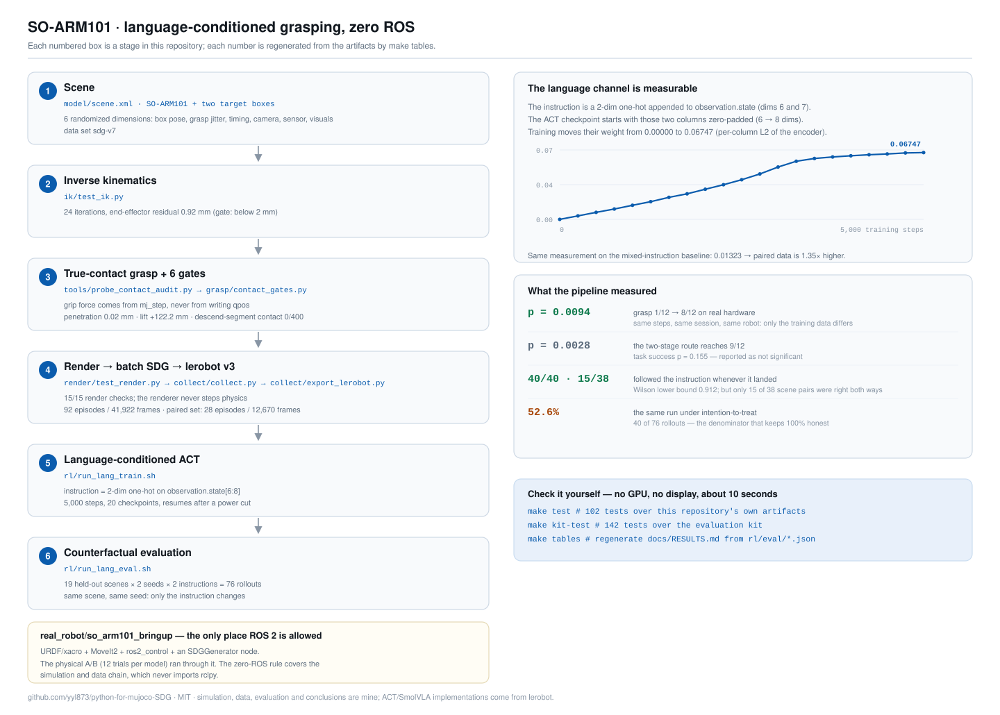
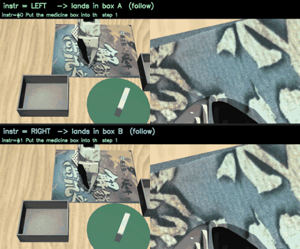

# 纯 MuJoCo 仿真 → 语言条件抓取（零 ROS）

[](https://github.com/yyl873/python-for-mujoco-SDG/actions/workflows/ci.yml)
[](https://github.com/yyl873/embodied-eval-kit/actions/workflows/ci.yml)


逆运动学 → **真接触**抓取（不写 `qpos`）→ 批量合成数据 → lerobot v3 → 语言条件 ACT → **反事实配对评测**证明语言真的进了策略。仿真与数据链路不 `import rclpy`；真机侧的 ROS 2 隔离在 `real_robot/`。

## 三个数字

| 指标 | 实测 | 口径与出处 |
|---|---|---|
| **真机抓取成功率** | **8.3% → 66.7%**（1/12 → 8/12），两阶段微调后 **75.0%**（9/12） | 同场次、同 22500 步、同机器、同推理参数，只差训练数据 → Fisher **p = 0.0094**；微调后 vs 纯真机 **p = 0.0028**，n=12 pilot |
| **手指穿模深度** | **0.02 mm** | 闸门 ≤1.6 mm；52/1968 个顶点越界。对照：换指垫前固定指壳在完全下探时穿进盒体 **22.6 mm**，那是"戳"不是"夹" |
| **真实抬升** | **+122.2 mm**（水平搬运 218.1 mm） | 闸门 ≥50 mm；握持力来自 `mj_step` 接触（峰值 2.37 N，药盒重力 0.113 N），全程不写 `qpos` |

语言侧同口径的三个数：[落对 **40/40 = 100%**（Wilson 下界 0.912）](docs/RESULTS.md)、**配对全对 15/38**、ITT **52.6%**；那 2 维语言通道的权重从 **0.00000** 训到 **0.06747**。
对照：混叠数据的 v1 在同一评测里"看起来"有 **56.4%**，但它的**配对全对是 0/38**——因为数据里"指令"和"场景"共线，这个 56.4% 只是"总往右放"的副产品。把指令和场景解耦（同场景两条指令首帧 `qpos` 差 **0.000e+00**）之后，才有 15/38 这个真数字。

## 真物理：六项接触闸门（"合成数据"和"摆拍"的区别）

假抓取很容易做得好看：指尖压在盒顶往下揉，再整体抬起来——视频里像抓到了，实际载荷是
"往下压"而不是"两侧夹"，松爪那一刻盒子就掉。所以判据不是"抬起来了没"，而是六个互相
独立的量，每个阈值都卡在物理行为发生变化的位置上（`docs/PHYSICS_FACTS.md` §2）：

| 闸门 | 判据 | 实测 | 它挡住什么 |
|---|---|---|---|
| **G1** 下探零接触 | `== 0` 步 | **0 / 400** | 指尖先落在盒顶，再"掐"着往上撑 |
| **G2** 不压进桌面 | `<= 0.5 mm` | **0.39 mm** | 把盒子压进桌面借力 |
| **G3** 不撞倒 | `<= 5°` | **1.06°** | 接近段就把盒子顶翻 |
| **G4** 真抬起来 | `>= 50 mm` | **+122.22 mm** | G1–G3 靠"根本不碰盒子"刷绿 |
| **G5** 无缝隙也无插穿 | `\|gap\| <= 1.2 mm` | **−0.85 / −1.07 mm** | 松到能滑出，或指头插进盒壁 |
| **G6** 无深穿模 | `<= 1.6 mm` | **0.02 mm** | 指壳整块插进盒体（上一版 **7.5 mm**） |

判据的唯一实现是 [`grasp/contact_gates.py`](grasp/contact_gates.py)：每条闸门带 `protects`（挡住什么）
和 `rationale`（**为什么是这个数**，不是随口取整），`docs/PHYSICS_FACTS.md` 里的阈值由测试强制对齐——
文档和代码不可能悄悄漂移。

```python
from grasp.contact_gates import evaluate

report = evaluate({                       # 一次 rollout 的实测值，全部来自 mj_step 采样
    "descend_contact_steps": 0, "press_mm": 0.39, "tilt_at_grasp_end_deg": 1.06,
    "rise_mm": 122.22, "gap_fixed_mm": -0.85, "gap_jaw_mm": -1.07, "pen_depth_mm": 0.02,
})
report.ok            # True
report.failed        # ()  —— 不通过时给出是哪几条，不是一句"抓取失败"
print(report.to_markdown())
```

抓取本身也验过：IK 24 次迭代收敛、末端残差 **0.923 mm**；握持力峰值 **2.37 N**（药盒自重 0.113 N），
法向 z 均值 **−0.002**（+1 是纯下压、0 是纯侧夹）。

## 一次排障：65° 的腕部冲突

1. 真机换成带指垫的夹爪后，凡是"抓到了却放不掉"的 9 次，模型张开夹爪那一刻的 `wrist_flex` 均值停在 **≈39°**——真机数据是 **+63°**、仿真数据是 **−2°**，39° 是**两套数据里都不存在的位姿**。
2. 根因：指垫把 TCP 往后推了 **11 mm**，IK 为了够到同一个点就把整个腕部转了 **≈65°**；本臂 lift / elbow / flex **三轴平行**，末端指向只由三者之和决定，所以"每关节差 65°"和"之和差 65.9°（真机 +63.4 / 仿真 −2.5）"是同一件事——这个位姿在仿真里合法，在真机上就是提歪盒子并按不出释放姿态。
3. 先做排除法封死其它解释（带载张开 99.381 > 空载、张开量更大、关掉 temporal ensembling 无效、量程与标定正确），才敢说这是**两种指面配置**而不是闭环算错——所以修法是改指面或把指面位移写进 URDF，**不是继续调策略**。

完整证据链：[`docs/GRIPPER_RELEASE_DIAGNOSTIC.md`](docs/GRIPPER_RELEASE_DIAGNOSTIC.md) §11（含"只去指垫只能解决一半冲突"的限制）。

## 同一场景、同一初始状态，只改一个 one-hot

上面一条是"放进左边木箱"，下面一条是"放进右边木箱"（每条画面 = 策略看到的两路相机 `env` + `wrist`）：



▶ 完整画质：[`docs/assets/compare_left_right.mp4`](docs/assets/compare_left_right.mp4)（960×794，1.8 MB）

## 30 秒验证（不需要 GPU、不需要显示器）

```bash
make test        # 102 个测试：从 rl/eval/*.json 复算 README 里的每一个数字
make kit-test    # 134 个测试：评测工具包的统计与反事实协议
make tables      # 从 rl/eval/*.json 重新生成 docs/RESULTS.md（数字不许手抄）
make demo        # 出一条演示视频（可加 --mic 用语音下指令）
```

测试分两处，都是标准 pytest：`tests/`（102 个，仓库级：复算数字、守文档与代码对齐、守 README 链接）
和 `embodied-eval-kit/tests/`（134 个，评测工具包的统计与反事实协议）。两个仓库都跑 CI，badge 点进去看得到绿。

`make test` 里的每个断言都指向一个已入库的产物：`40/40`、`15/38`、`p=0.0028`、`p=0.0094` 不是写死的字符串，而是从 `rl/eval/*.json` 用 [`embodied-eval-kit`](embodied-eval-kit/README.md) 重算出来的结果——数字对不上，测试就红。

## 仓库结构

```
model/               MJCF 与 14 个网格（改模型只动这里）
ik/ grasp/ render/ collect/   仿真四步；grasp/contact_gates.py 是六项接触闸门的唯一实现（有单测）
rl/                  训练壳（断电续跑/降档/显卡闸门）、反事实评测、演示与语音链路
real_robot/          真机侧 ROS 2 bringup（URDF + MoveIt2 + ros2_control + SDGGenerator 节点）——唯一碰 ROS 的地方
embodied-eval-kit/   可独立发布的评测工具包：手写精确统计 + 反事实配对协议 + 三态回执（134 个测试，零依赖）
tests/               仓库级 pytest：复算已发布数字、守 README 链接、守结果表新鲜度
tools/               入口工具；tools/probes/ 是一次性排障脚本（保留为可复现证据）
docs/                6 份文档 + 自动生成的 RESULTS.md（索引见 docs/README.md）
```

## 诚实的边界

- `follow_acc 100%` 的分母是 **40 条落进箱子的 rollout**；含失败的口径是 **ITT 52.6%**（40/76）。两个数必须一起看。
- 语言是 **2 维 one-hot（左/右）**，**不是自由文本理解**，换说法不支持；策略**只在仿真里评测过**，没做真机闭环。
- 真机 A/B 是 **n=12 的 pilot**：抓取显著（p = 0.0094 / 0.0028），**任务成功率 p = 0.155 未达显著**。
- 我做错过一次结论：先用一个数据量/步数都不对齐的对照得出"仿真无增益"，被同场次同步数的干净对照推翻。两次修正都留在 [`docs/REAL_AB_RESULTS_2026-10-28.md`](docs/REAL_AB_RESULTS_2026-10-28.md) §9–§10 里。
- 残差 RL **是负结果**：洁净口径 26.7% → 13.3%，根因是奖励被钻空子（穿透罚 −3 ≫ 抓取奖 +0.5）。如实判负，见 [`docs/REPORT_RESIDUAL_RL.md`](docs/REPORT_RESIDUAL_RL.md)。
- 缺项：现代 BC 对照（DP / VQ-BeT 只差跑一次）、chunk_size 等消融、文本指令版、真机闭环。

## 文档

| 文档 | 给谁看 |
|---|---|
| [`docs/RESULTS.md`](docs/RESULTS.md) | **自动生成**的三张结果表 |
| [`docs/ROUND_lang_pair_5000.md`](docs/ROUND_lang_pair_5000.md) | 语言条件这一轮的完整报告（口径 / 失败拆解 / 边界） |
| [`docs/GRIPPER_RELEASE_DIAGNOSTIC.md`](docs/GRIPPER_RELEASE_DIAGNOSTIC.md) | 释放失败的根因链（就是上面那个 65°） |
| [`docs/PHYSICS_FACTS.md`](docs/PHYSICS_FACTS.md) | 生效的物理事实、六项闸门实测值、不许动的参数 |
| [`docs/RUNBOOK_SDG.md`](docs/RUNBOOK_SDG.md) | 操作手册：刷数据、导出、跑 1000 条 |
| [`docs/REPORT_RESIDUAL_RL.md`](docs/REPORT_RESIDUAL_RL.md) | 残差 SAC 的负结果与根因 |
| [`tools/probes/README.md`](tools/probes/README.md) | 一次性排障脚本各自回答过什么问题 |

策略实现不是我写的：[lerobot](https://github.com/huggingface/lerobot) 提供 ACT / SmolVLA 与数据格式，[SO-ARM101](https://github.com/TheRobotStudio/SO-ARM100) 提供本体模型。我写的是**仿真、数据、评测与结论**。真机 bringup 包保留 Apache-2.0 许可。

MIT（`model/` 内网格素材与第三方库遵循各自许可）。